<p align="center">
  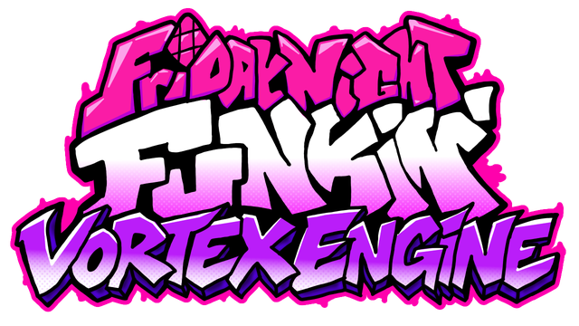
</p>

<p align="center">
  <b>A Psych Engine 1.0.4 fork that also runs V-Slice mods, adds online multiplayer, and brings the new Funkin' menus to every mod.</b>
</p>

<p align="center">
  <a href="https://veritonr.github.io/Vortex-Engine/"></a>
  <a href="https://discord.gg/QKjMSpeHW"></a>
</p>

<p align="center">
  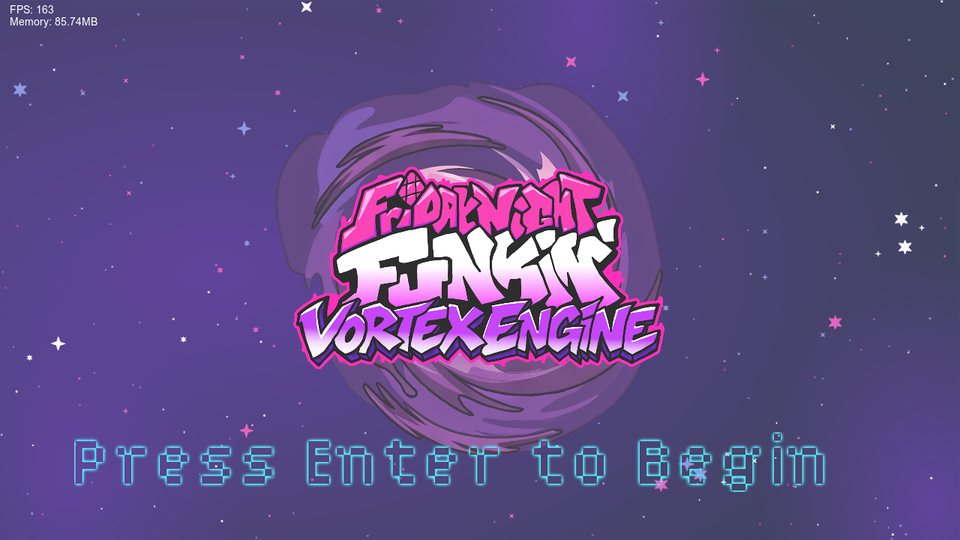
  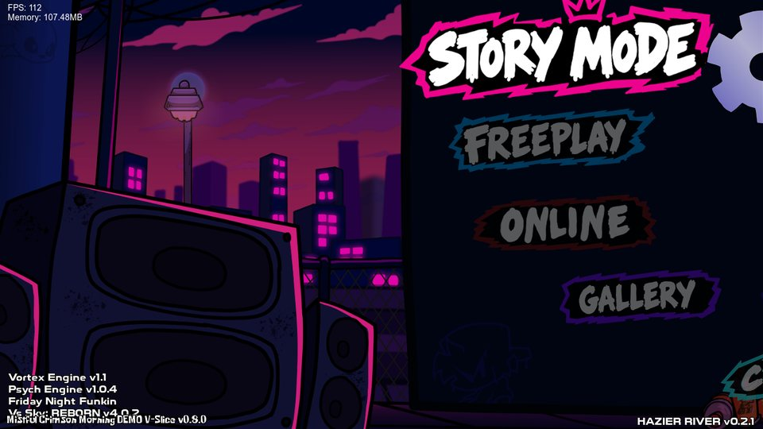
</p>

---

## Highlights

| | |
|---|---|
| 🧩 **V-Slice mod support** | Play mods made for the official game (Polymod, `.hxc` scripts) next to your Psych mods, with no porting. |
| 🌐 **Online multiplayer** | Host or join a match by IP and play a song against a friend: each player sings one side. The port opens by itself (UPnP), there's a chat, and a missing mod can be sent to the other player. |
| 🎓 **Tutorials** | A "Tutorial" button on the menus and editors: Boyfriend zooms into each part of the screen and explains it. Mods can add their own. |
| 📸 **Screenshots & Gallery** | `F3` takes a screenshot anywhere, with a flash and a preview; the Gallery shows them and saves copies. |
| 🎤 **V-Slice menus for everyone** | Freeplay with the DJ, Character Select, the Results screen and the sticker transition, for Psych songs too. |
| 🎮 **New gameplay options** | Play as Opponent, Health Drain, Break Timer, Lane Underlay, Ghost Notes, Hold Note Covers and more. |
| 👥 **Extra characters** | Add more singers to a song in the chart editor (a duet, a third character...) and pick who sings each note, with no script. |
| 🛠️ **Better editors** | Box selection in the chart editor, mouse tools and undo in the other editors, plus a new Character Select / Results editor. |
| 📜 **More scripting** | New Lua and HScript functions, callbacks and properties, listed in [`scripts.txt`](scripts.txt). |

---

## 🧩 V-Slice (Polymod) mod support

Put a V-Slice mod in the `mods` folder and it shows up in the game like any other mod.

* **Scripts:** `.hxc` scripts run through Vortex's own interpreter: song, stage, character, module, dialogue, Freeplay and results scripts.
* **Content:** V-Slice charts (`-chart.json` / `-metadata.json`, every difficulty and variation), stages, characters (Sparrow, Packer, multi-sparrow and Adobe Animate atlases), song events (`FocusCamera`, `ZoomCamera`, `SetCameraBop`, `PlayAnimation`, ...), note kinds and dialogue conversations.
* **Utility mods:** a V-Slice mod with scripts and no songs of its own (a custom pause menu, HUD or camera module) runs on the V-Slice songs of every mod, like on V-Slice.
* **Playable characters:** a mod's playable characters appear in Character Select and bring their own Freeplay DJ and results animations.
* **Built-in base game content:** the V-Slice versions of the base weeks, stages and characters come with the engine, so mods that depend on them work without the official game installed.
* Made for mods targeting the V-Slice 0.8.x API (the one from 0.8.0 up to the latest 0.8.6).

<p align="center">
  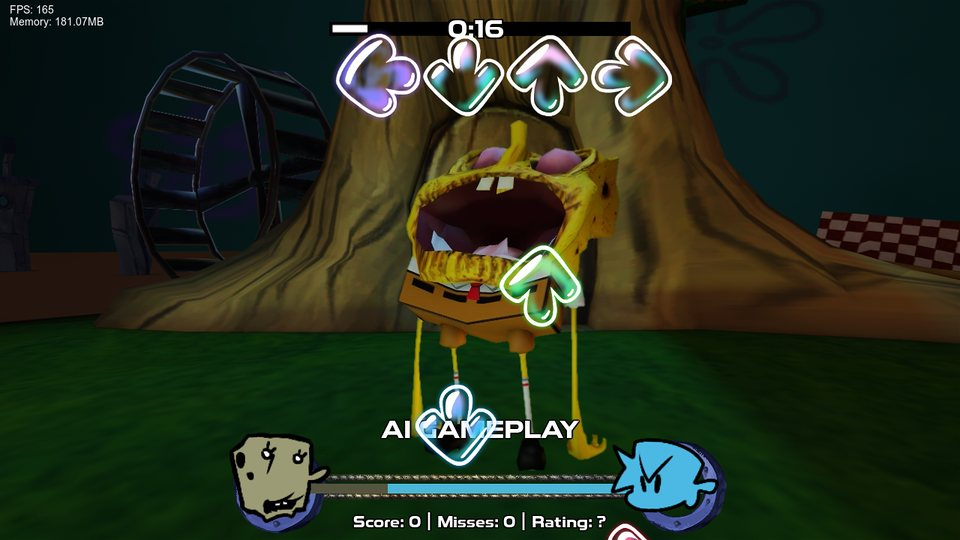
  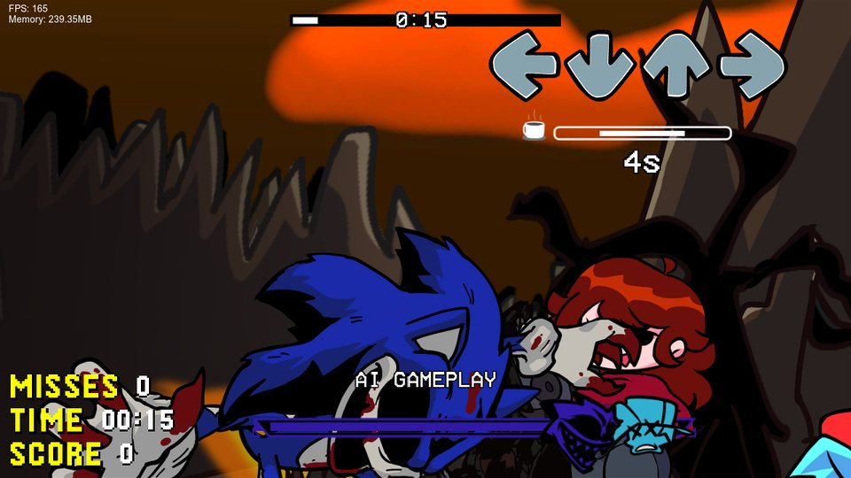
  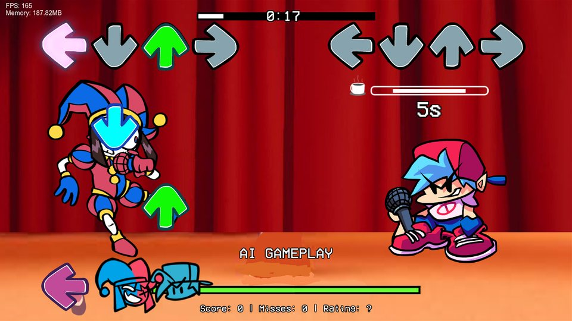
  <br><sub>Community V-Slice mods running as they are. The mods belong to their creators.</sub>
</p>

---

## 🎤 V-Slice menus, for every mod

Each of these is an option, and Psych mods get them too.

<p align="center">
  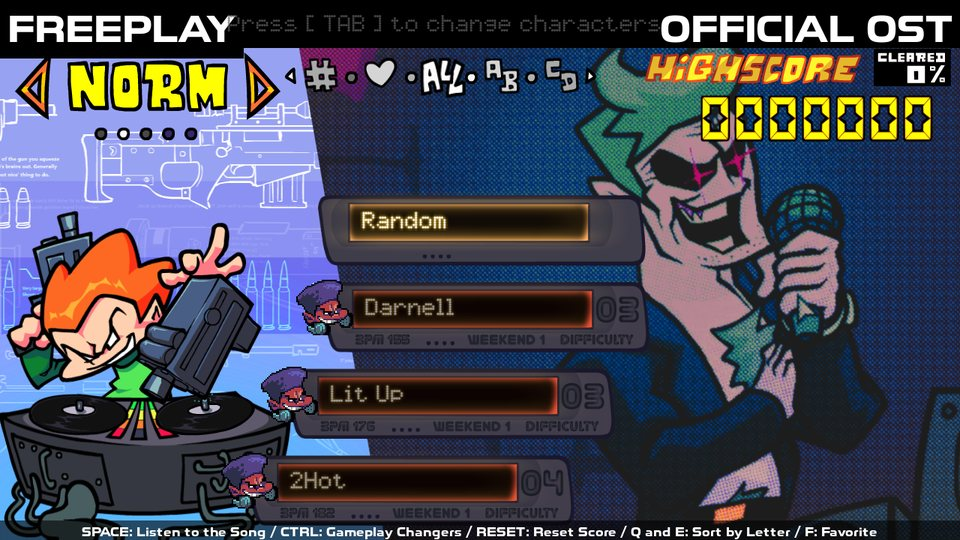
  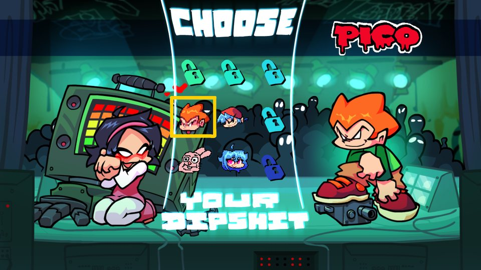
</p>

* **Freeplay style:** pick the classic Psych Freeplay or the V-Slice one, with the DJ, capsules, the "NEW" badge on songs you haven't played yet, favorites and sorting.
* **Character Select:** switch characters (press `TAB` in Freeplay) like in the official game.
* **Results screen:** ratings tally and rank animations (Perfect, Excellent, Great, Good, Loss) after each song.
* **Sticker transition** between Freeplay and the songs.

<p align="center">
  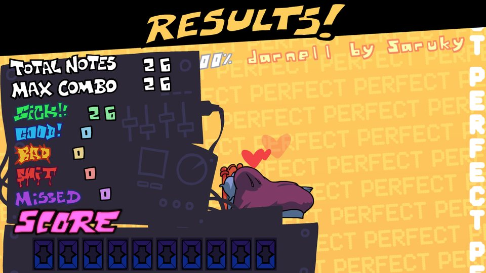
</p>

---

## 🌐 Online multiplayer

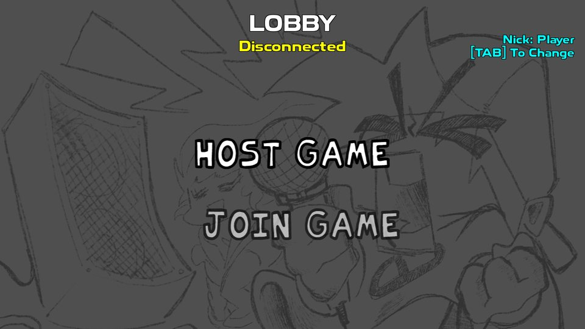

* **Host Game** waits for a friend; **Join Game** connects with the host's IP (port `8888`). `CTRL+V` pastes the IP.
* **No Radmin or Hamachi needed (when the router allows it):** hosting asks the router to open the port by itself (UPnP) and shows the IP to send to your friend (`C` copies it). If the router can't (UPnP off, or an internet provider that shares one IP between many homes, called CGNAT), the screen says so, and a VPN like Radmin still works.
* Choose your nickname in the lobby (`TAB`).
* **Chat:** `T` opens it on any screen of the match (the lobby, the song, the results). Its key can be changed in Controls.
* **The other player's preferences:** `P` in the lobby shows them (downscroll, middlescroll, lane underlay, ghost tapping, note skin, offset, FPS). With the option **Online: Opponent's View**, you see their notes the way they do: going down if they use downscroll, with dark lanes if they use Lane Underlay.
* **Sending a mod:** if the host picks a song from a mod the other player doesn't have, the other player is asked if they want it (with its size, and a warning that mods can have scripts). If they accept, the host sends the mod's files, it's installed and turned on, and the match starts. A mod they have but turned off is only turned on.
* Each player plays one side of the chart, and both see each other's notes, misses and animations as they happen.
* **Match setup:** after picking the song, the host chooses how the match is won (**Score**, **Misses** or **Accuracy**) and the sides; the other player watches it live.
* During the song, the other player's score, misses and accuracy are in a corner, with who's ahead. Getting knocked out loses; if nobody is, a results screen shows both players side by side and who won.
* Health drain added by a mod for the opponent's notes is blocked online, because the match already handles health.
* Scripts can check `onlinePlay` / `onlineHost` to change mechanics that would be unfair online.

<br clear="right">

---

## 🎮 Gameplay

<p align="center">
  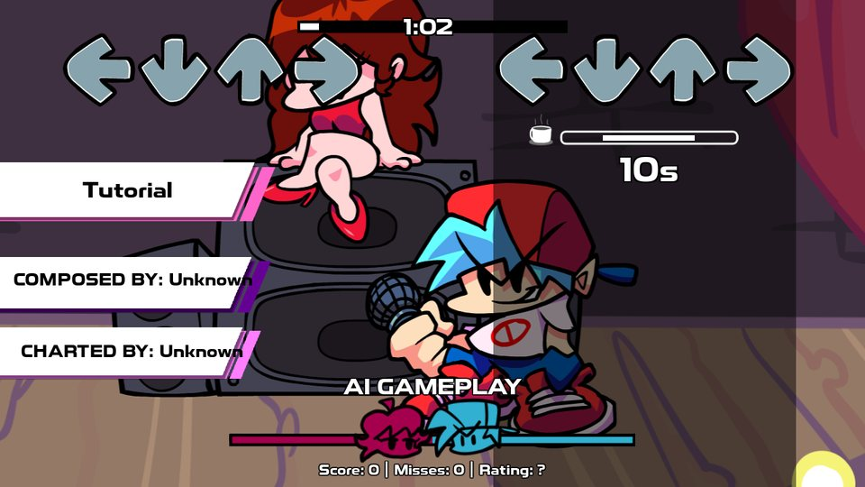
  <br><sub>Lane Underlay, the Break Timer ("10s") and the Song Credits Card.</sub>
</p>

**Gameplay changers**
* **Play as Opponent:** play the opponent's notes while the computer plays Boyfriend's.
* **Health Drain:** every note the opponent hits takes a little health (it never kills you).
* **Speed Up on Miss:** every miss makes the song 5% faster, up to 2x.
* **Ghost Notes:** two notes of the same character close together leave an afterimage of the first pose, in the animation the character was in.
* **Only Sick:** anything worse than a Sick counts as a miss.
* **Random Chart:** every note goes to a random column (notes at the same time never land on the same one).
* **Random Scroll Invert:** every 16 beats, the receptors may glide to the other side of the screen, and the notes turn around with them.
* **Fade In / Fade Out:** the notes appear only near the receptors, or disappear before reaching them.
* **Random Note Speed:** each note comes at its own speed.

**New options**
* **Break Timer:** a countdown when there are 3 seconds or more without notes.
* **Click Between Frames** (Windows): like the Geometry Dash mod, each key press counts from the moment it was made, not from the start of the next frame, for more precise hits (mostly at low framerates).
* **Lane Underlay:** dark lanes under your notes, with adjustable opacity.
* **Hold Note Covers:** the sparks on the receptors while you hold a long note.
* **Sustain Wiggle**, **Icon Bop**, **Smooth Health Bar** and **Sustains as One Note**.
* **Score Camera:** ratings and combo pop up on the HUD or in the stage.
* **Song Credits Card:** the song's name, composer and charter slide in when the song starts.
* **Animated health icons** (an `.xml` next to the icon) and **winning icons** (3 frames).
* **Window Mode** (windowed or fullscreen) and **Sharpness**.
* **Keystrokes:** the keys you press, shown during songs and lit while held, with keys per second. **WASD** lays them out like W A S D,**DFJK** in a row (songs that don't have 4 arrows always use the row). They and the Break Timer are on a camera of their own over every other one, so songs that hide or move the HUD don't take them away.
* **Supersampling:** the game is drawn bigger than the window and shrunk to it, for smoother edges (like DSR on NVIDIA cards).
* **The options menu** is one panel with tabs (Gameplay, Graphics, Visuals, V-Slice, Vortex Engine, Mods and More), usable with the keyboard or the mouse. The note and splash settings show the arrows, with the splashes playing.
* **Mods tab:** the settings mods add, each mod under its name. V-Slice mods add theirs the way they do on V-Slice (`createPrefItemCheckbox`, `createPrefItemEnum`, `createPrefItemNumber` and `createPrefItemPercentage` on the options menu's pages, from a module's `onStateChangeEnd`), and Psych mods with their `data/settings.json`.
* **Controls:** two actions on the same key that work during a song (a note key that's also the chat's, for example) get a warning.

---

## 🎹 Extra keys (1 to 9 arrows)

Songs can have more or fewer than 4 arrows per side, for mods like Shaggy's 6 and 9 key songs.

* **In the chart:** `"keyCount": 6` (Psych Engine Extra Keys' `"mania"` works too: its number plus one). The notes are `0` to `keyCount - 1` on one side and `keyCount` to `keyCount * 2 - 1` on the other, like Psych's 0-3 and 4-7.
* **In the chart editor:** "Arrows per side" in the Song tab. Changing it keeps each note on its side and in its column (as far as there are columns).
* **The arrows:** each column uses one of the 4 arrows, or the middle one (the "space" key, drawn with the up arrow), with the color of its direction from Note Colors; a second arrow of the same direction gets another color. They get smaller the more there are.

| Arrows | Columns | Default keys |
| --- | --- | --- |
| 1 | middle | Space |
| 2 | ← → | F J |
| 3 | ← middle → | F Space J |
| 5 | ← ↓ middle ↑ → | D F Space J K |
| 6 | ← ↑ → ← ↓ → | S D F J K L |
| 7 | ← ↑ → middle ← ↓ → | S D F Space J K L |
| 8 | ← ↓ ↑ → ← ↓ ↑ → | A S D F H J K L |
| 9 | ← ↓ ↑ → middle ← ↓ ↑ → | A S D F Space H J K L |

* **Keys:** Options → More → **Extra Keys** (UP/DOWN pick how many arrows, LEFT/RIGHT the arrow, ENTER changes its key, R puts the default ones back).
* Characters sing the animation of the arrow's direction (the middle one sings up). Scripts see the column as always, in `noteData`.

<p align="center">
  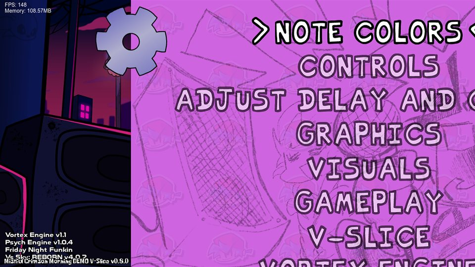
  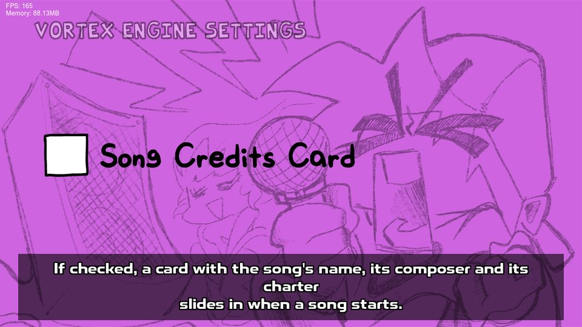
  <br><sub>The options menu slides in straight from the main menu. All of Vortex's options have their own page.</sub>
</p>

---

## 🛠️ Editors

<p align="center">
  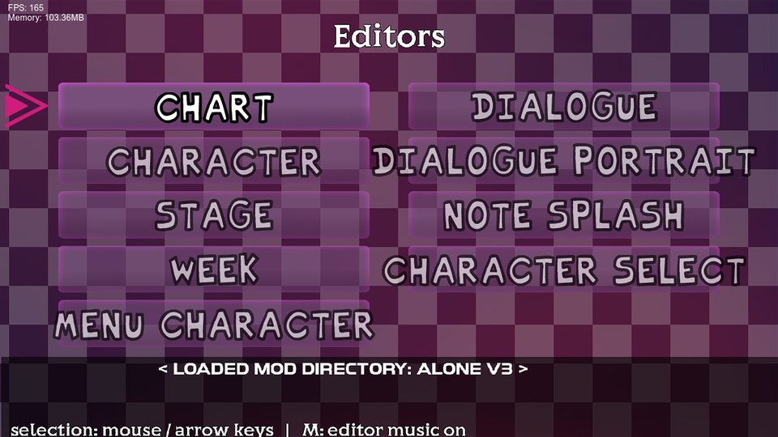
  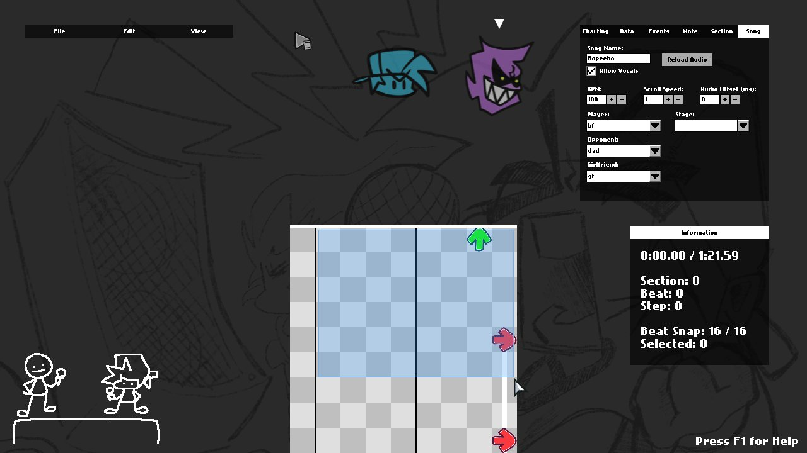
</p>

* **Chart Editor:** a music player bar at the bottom (like V-Slice's): drag it to go anywhere in the song, play/pause and skip with its buttons, and see the time left, beat, step, BPM and snap. Drag a box with the mouse to select notes, drag the selection to move it, cut / copy / paste and undo. Music plays when you leave it idle, like in V-Slice (`M` turns it off).
* **Extra characters:** the chart editor's "Extras" tab adds characters besides the opponent, the player and the girlfriend (a character, a side, where it stands). Each one gets a field of its own on the grid, like Codename Engine's strumlines, to chart its notes; the Note tab's "Sung by" also picks who sings each note: the main character, an extra one, or everyone on that side. They dance, sing, hold long notes and miss like the main ones; scripts get them by their tag. See section 8 of [`scripts.txt`](scripts.txt).
* **New chart events:** Flash Camera, Fade Screen, Set Camera Zoom, Fade HUD, Cinematic Bars, Lyrics, Camera Target, Camera Bop, Character Trail, Notes Fade and Camera Angle, with no script needed (see section 10 of [`scripts.txt`](scripts.txt)). A mod with its own event of the same name keeps its own.
* **Stage, Character, Dialogue Portrait and Menu Character editors:** move things with the mouse, with undo.
* **Character Select & Results editor (new):** place the characters, portraits and results animations of a playable character, with a live preview. What you save works in the official V-Slice too. The character can also be a spritesheet (`.png` + `.xml`) instead of a texture atlas, in the "Player Sheet" tab (Vortex only: V-Slice needs the atlas).
* Every editor has a **Tutorial** button (see below).

<p align="center">
  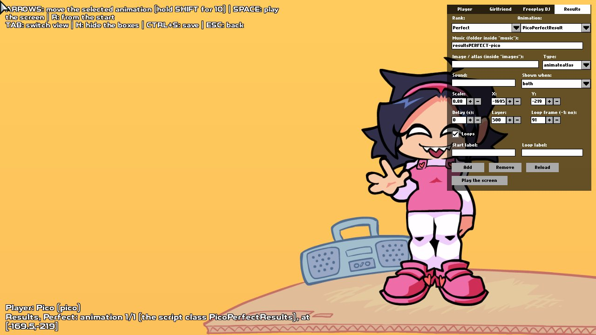
  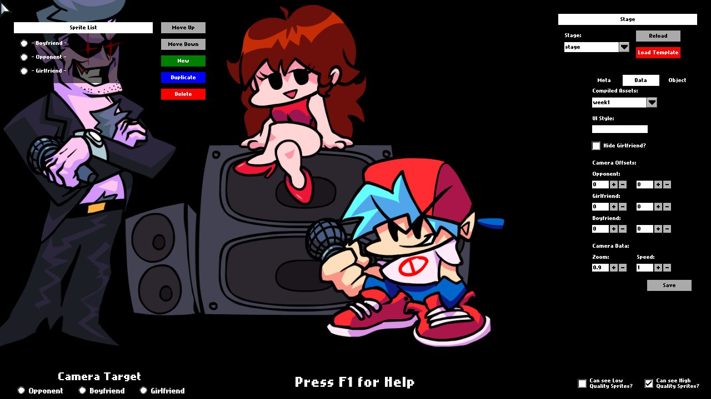
</p>

---

## 🎓 Tutorials

The menus and the editors that have a tutorial show a **Tutorial** button (`F6` also opens it). Boyfriend comes in, the screen zooms into each part he talks about, and a speech bubble explains it. `ENTER` or a click goes on, `BACKSPACE` goes back, `ESC` leaves.

There are tutorials for the main menu, Freeplay (both styles), the options, Online, the mods menu, the Gallery, the editors menu, and the Chart, Character, Stage and Character Select editors.

The button can be hidden in Options → Vortex Engine → **Tutorial Button**.

**Making one for your mod:** add `data/tutorials/<ScreenName>.json` to the mod, named after the screen's class (`MainMenuState`, `ChartingState`, a custom state's class...). A mod's tutorial replaces the game's one for that screen.

```json
{
	"button": "top-right",
	"steps": [
		{"text": "Hi! This step has no target: the whole screen is shown."},
		{"text": "This is the song list.", "target": "grpSongs", "zoom": 1.5},
		{"text": "The Note tab.", "target": "mainBox", "set": {"mainBox.selectedName": "Note"}},
		{"text": "A spot of the screen.", "rect": [100, 100, 300, 200], "pose": "up"}
	]
}
```

* `target`: the name of something on the screen (a variable of the state), or several in a list. Dots go inside it: `"mainBox.tabs.Note"`, `"menuItems.members.2"`.
* `rect`: a place on the screen instead, `[x, y, width, height]` (the screen is 1280x720). `area` picks a part of the target the same way, from its corner.
* `zoom`: how close it goes (2 by default; it never goes closer than what fits).
* `set`: values changed while the step is shown (a tab, a menu opened...). Everything goes back to how it was when the tutorial ends.
* `pose`: what Boyfriend does: `hey`, `left`, `down`, `up`, `right` or `idle`. By default he looks at what he's showing.
* `button`: where the button goes: `top-left`, `top-center`, `top-right`, `bottom-left`, `bottom-center`, `bottom-right`, or `[x, y]`.
* Translations: add `"key": "mymod_menu"` to the file, and the language files' `mymod_menu_1`, `mymod_menu_2`... replace the steps' texts (counting from 1). The game's own tutorials use `tutorial_<screenname>`.

---

## 📸 Screenshots and the Gallery

`F3` (it can be changed in Controls) takes a screenshot of the game anywhere, with a flash (if Flashing Lights is on), a camera sound and a small preview in the corner. Clicking the preview opens the folder.

The pictures go to `mods/images/gallery`, and the **Gallery** shows them along with the images of the game and of the mods. `S` (or its button) saves a copy anywhere on the computer.

---

## 📜 Scripting

Everything Psych Engine's Lua and HScript can do still works, and so do V-Slice's `.hxc` scripts. On top of that, Vortex adds:

* **State scripts:** a `states` folder with one `.hx` per screen (`MainMenuState.hx`, `LoadingState.hx`, ... and `Global.hx` for all of them) to change the menus and make your own loading screen. See the full guide below.
* `VortexEngine`, `playAsOpponent`, `onlinePlay` and `onlineHost` variables.
* Functions such as `setLaneUnderlay`, `setScoreCamera`, `setHiddenNotes`, `getTallies` and `startConversation` (V-Slice dialogue in Psych songs).
* Lua cameras of your own (`makeLuaCamera`), shaders on whole cameras (`addCameraShader`, `tweenShaderFloat`), the game's window (`setWindowTitle`, `setWindowPosition`, `setWindowSize`, `windowAlert`...), notes added during the song (`spawnNote`), extra characters added or taken out during the song (`addExtraCharacter`, `removeExtraCharacter`) and the clipboard.
* **3D:** Lua sprites, receptors and notes turned with `angleX`, `angleY` and `z`; whole cameras turned with `setCamera3D` / `tweenCamera3D` (tilt the HUD like a 3D modchart); and `.obj` models with a texture and lighting (`makeLuaModel`). See section 13 of [`scripts.txt`](scripts.txt).
* Callbacks such as `onBreakStart` and `onBreakEnd`.
* Overlay, hardlight, difference and invert blend modes that really work on Lua sprites.
* Camera rotation without empty corners: no `zCameraFix` scripts needed.

The full list, with examples, is in [`scripts.txt`](scripts.txt) and on the [website's Lua API page](https://veritonr.github.io/Vortex-Engine/lua.html). Everything on [Psych Engine's Lua Script API page](https://shadowmario.github.io/psychengine.lua/) works in Vortex too.

### 🖼️ State scripts: change the menus and the loading screen

Put HScript files in a `states` folder of your mod, named after the screen they're for, and they run on it:

```
mods/My Mod/states/
├─ Global.hx           ← every screen
├─ MainMenuState.hx    ← the main menu
├─ FreeplayState.hx    ← Freeplay
└─ LoadingState.hx     ← the loading screen before a song
```

```haxe
// mods/My Mod/states/MainMenuState.hx
function onCreatePost() {
	var hello = new FlxText(20, FlxG.height - 70, 0, 'Hello from my mod!', 28);
	add(hello);
}
```

* Callbacks: `onCreate`, `onCreatePost`, `onUpdate`, `onUpdatePost`, `onStepHit`, `onBeatHit`, `onOpenSubState`, `onCloseSubState`, `onDestroy`.
* The screen's own things are reached by their names (`optionsGear.visible = false;`), and `add()` / `insert()` / `remove()` work on it.
* **Custom loading screens:** `onLoadingProgress(loaded, total, percent)`, and `onFinishedLoading()` returning `Function_Stop` keeps the screen on until `finishLoading()` (a minimum time, "Press ENTER to continue", a fade...).
* `switchState('CreditsState')`, `debugPrint()`, `parseJson()` and `sharedData` (data kept from one screen to the next, or for the song's scripts).

📖 **Full guide, with every screen name, callback and function, and complete examples: [`docs/STATE_SCRIPTS.md`](docs/STATE_SCRIPTS.md)** · Template: [`docs/scripts/StateTemplate.hx`](docs/scripts/StateTemplate.hx)

> [!WARNING]
> **Mods made with Vortex Engine are not recommended for other engines.**
> Many features only exist in Vortex: the functions, variables and callbacks above, the extra blend modes, the gameplay changers, V-Slice dialogue in Psych songs, online checks and the files made by its editors. A mod that uses any of them will break or behave differently on Psych Engine, V-Slice or other forks.
> A mod made in Vortex can only be expected to work elsewhere if it **doesn't use any of Vortex's exclusive mechanics** (plain Psych Engine 1.0.4 Lua/HScript, or plain V-Slice content).
> If you want your mod to run on other engines too, check for Vortex with the `VortexEngine` variable before using these features.
> The **CHECK MOD** button in the mods menu lists everything a mod uses that only Vortex has, with the file and line of each one.

---

## Installation

Refer to [the Build Instructions](/docs/BUILDING.md).

## Customization

If you wish to disable things like *Lua Scripts* or *Video Cutscenes*, you can refer to the `Project.xml` file.

Inside `Project.xml`, you will find several variables to customize the engine to your liking.

To start you off, disabling *Video Cutscenes* should be simple: delete the line `"VIDEOS_ALLOWED"` or comment it out by wrapping the line in XML-like comments, like this: `<!-- YOUR_LINE_HERE -->`

Same goes for *Lua Scripts*: comment out or delete the line with `LUA_ALLOWED`. This and other customization options are all available within the `Project.xml` file.

### A build for mod makers (no base songs)

A copy of the engine **without the songs and weeks of the base game** (Psych's and V-Slice's), so that only a mod's own songs show up in Freeplay and Story Mode. It's meant for people making a mod with Vortex Engine, or shipping their own modified version of it, who would otherwise have to delete the base songs by hand.

Nothing besides Haxe has to be installed: the export runs with Haxe itself, the same one that builds the game (on Windows, Linux and Mac). There's no Python or anything else to set up.

**Step by step**

1. Build the game as usual, with your own changes to the source if you made any:
   ```
   lime build windows
   ```
2. Export the clean version. On Windows, double click `art/export_clean_build.bat`. On any system, open a terminal in the engine's folder (the one with `Project.xml`) and run:
   ```
   haxe art/export_clean_build.hxml
   ```
3. The result is in `export/clean`. Open `VortexEngine.exe` there to check it: the menus work, Freeplay and Story Mode are empty, and every song added under `mods/` shows up alone.
4. To share it, add `--zip` (`haxe art/export_clean_build.hxml --zip`, or `export_clean_build.bat --zip` in a terminal) and send `export/clean.zip`.

It prints what was copied and what was left out, like this:

```
Copied: 2299 files, 477.0 MB
Left out (base songs): 6, 448.2 MB
Left out (base cutscene): 3, 26.5 MB
Left out (base song chart): 29, 2.0 MB
Left out (base weeks): 10, 0.0 MB
```

**What's in it:** the engine, the characters, the stages and their images, the note skins, the menus, Freeplay's DJs, Character Select, the results screen, the sounds and music of the menus, and the V-Slice base content that mods use (characters, stages, note styles...).

**What's left out:**
- Psych's songs: their audio (`assets/songs`), their charts (`assets/shared/data/<song>`), the weeks (`assets/shared/weeks`) and the cutscene videos (`assets/videos`).
- V-Slice's base songs: their audio, charts and levels (`assets/vslice/songs`, `data/songs`, `data/levels`), their scripts (`scripts/songs`) and their videos (`assets/vslice/videos`).
- What's only on your computer: your `mods` folder (a clean one with its `readme.txt` and the mod template takes its place), the chart editor's backups, the mods list, the logs and the script error files.

**Options** (after the command, or after the `.bat` in a terminal):

| Option | What it does |
| --- | --- |
| `--zip` | Also makes `export/clean.zip`, ready to share. |
| `--dry` | Only shows what would be copied and left out. Nothing is written. |
| `<game folder> <output folder>` | Uses other folders. For example, for a Linux build: `haxe art/export_clean_build.hxml export/release/linux/bin export/clean-linux` |
| `--force` | The output folder is made again from nothing on every export. If it has something an export didn't put there (a file you saved in it, a mod inside its `mods` folder), the export stops and lists it instead of deleting it. `--force` deletes it anyway. |

The scripts are in `art/tools/`: `ExportCleanBuild.hx` is the export, and the folder lists at its top (`SKIP_ROOT`, `SKIP_DIRS`, `DATA_KEEP`) say what's left out, if your version of the engine needs other folders kept or removed.

### Custom mouse cursor

Put an image at `images/cursor.png` (the game's `assets/shared/images/`, or a mod's `images/` folder - the mod being played comes first) and it becomes the cursor on every screen. An optional `images/cursor.txt` next to it sets its size and the pixel that clicks: `scale, x, y` (for example `2, 0, 0`, or `1, 16, 16` for a 32x32 crosshair clicking with its middle).

---

## 💬 Community

Questions, bug reports, mods made with Vortex Engine, or someone to play online with: join the **[Vortex Engine Discord server](https://discord.gg/QKjMSpeHW)**.

---

## Credits

### Vortex Engine
* VeritonR - Creator of Vortex Engine.

### Psych Engine
* Shadow Mario - Main Programmer and Head of Psych Engine.
* Riveren - Main Artist/Animator of Psych Engine.

### Special Thanks
* bbpanzu - Ex-Team Member (Programmer).
* crowplexus - HScript Iris, Input System v3, and Other PRs.
* Kamizeta - Creator of Pessy, Psych Engine's mascot.
* MaxNeton - Loading Screen Easter Egg Artist/Animator.
* Keoiki - Note Splash Animations and Latin Alphabet.
* SqirraRNG - Crash Handler and Base code for Chart Editor's Waveform.
* EliteMasterEric - Runtime Shaders support and Other PRs.
* MAJigsaw77 - .MP4 Video Loader Library (hxvlc).
* iFlicky - Composer of Psync, Tea Time and some sound effects.
* KadeDev - Fixed some issues on Chart Editor and Other PRs.
* superpowers04 - LUA JIT Fork.
* CheemsAndFriends - Creator of FlxAnimate.
* Ezhalt - Pessy's Easter Egg Jingle.
* MaliciousBunny - Video for the Final Update.
* The Funkin' Crew - Friday Night Funkin' and V-Slice.

***

#### Vortex Engine by VeritonR · Psych Engine by ShadowMario · Friday Night Funkin' by ninjamuffin99 and The Funkin' Crew
