

  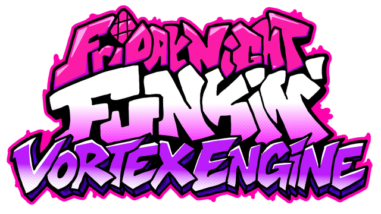

  <b>A Psych Engine 1.0.4 fork that also runs V-Slice mods, adds online multiplayer, and brings the new Funkin' menus to every mod.</b>

  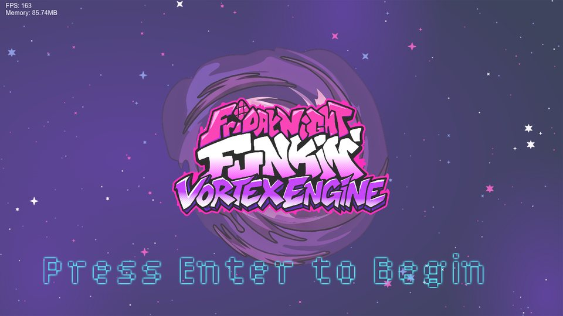
  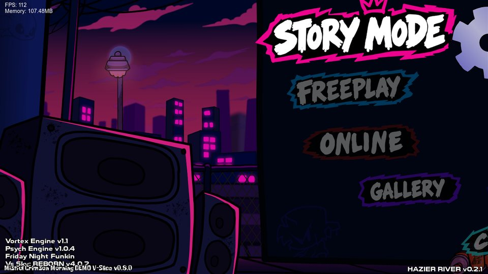

---

## Highlights

| | |
|---|---|
| 🧩 **V-Slice mod support** | Play mods made for the official game (Polymod, `.hxc` scripts) next to your Psych mods, with no porting. |
| 🌐 **Online multiplayer** | Host or join a match by IP and play a song against a friend: each player sings one side. |
| 🎤 **V-Slice menus for everyone** | Freeplay with the DJ, Character Select, the Results screen and the sticker transition, for Psych songs too. |
| 🎮 **New gameplay options** | Play as Opponent, Health Drain, Break Timer, Lane Underlay, Ghost Notes, Hold Note Covers and more. |
| 🛠️ **Better editors** | Box selection in the chart editor, mouse tools and undo in the other editors, plus a new Character Select / Results editor. |
| 📜 **More scripting** | New Lua and HScript functions, callbacks and properties, listed in [`scripts.txt`](scripts.txt). |

---

## 🧩 V-Slice (Polymod) mod support

Put a V-Slice mod in the `mods` folder and it shows up in the game like any other mod.

* **Scripts:** `.hxc` scripts run through Vortex's own interpreter: song, stage, character, module, dialogue, Freeplay and results scripts.
* **Content:** V-Slice charts (`-chart.json` / `-metadata.json`, every difficulty and variation), stages, characters (Sparrow, Packer, multi-sparrow and Adobe Animate atlases), song events (`FocusCamera`, `ZoomCamera`, `SetCameraBop`, `PlayAnimation`, ...), note kinds and dialogue conversations.
* **Playable characters:** a mod's playable characters appear in Character Select and bring their own Freeplay DJ and results animations.
* **Built-in base game content:** the V-Slice versions of the base weeks, stages and characters come with the engine, so mods that depend on them work without the official game installed.
* Made for mods targeting the V-Slice 0.8.x API (the one from 0.8.0 up to the latest 0.8.6).

  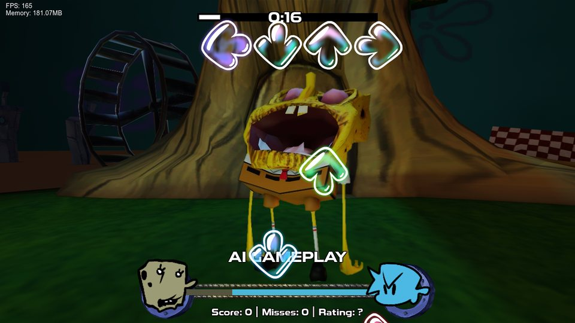
  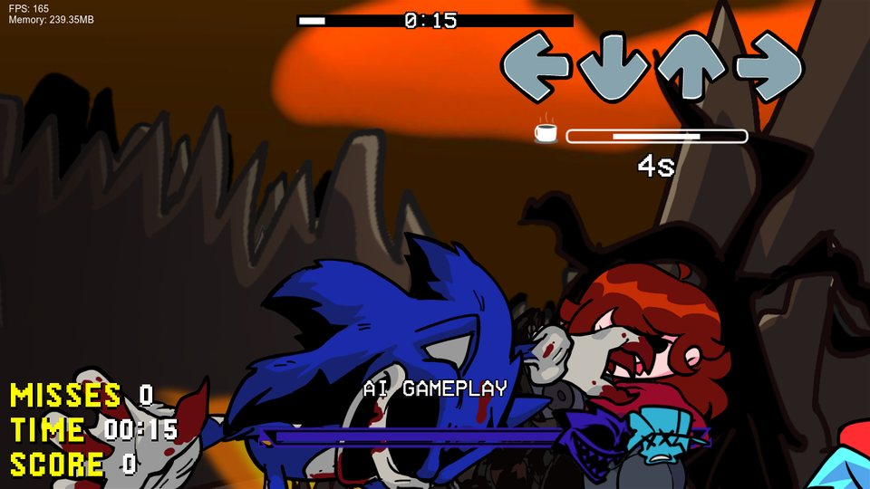
  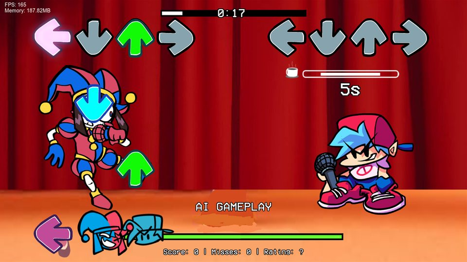
   Community V-Slice mods running as they are. The mods belong to their creators.

---

## 🎤 V-Slice menus, for every mod

Each of these is an option, and Psych mods get them too.

  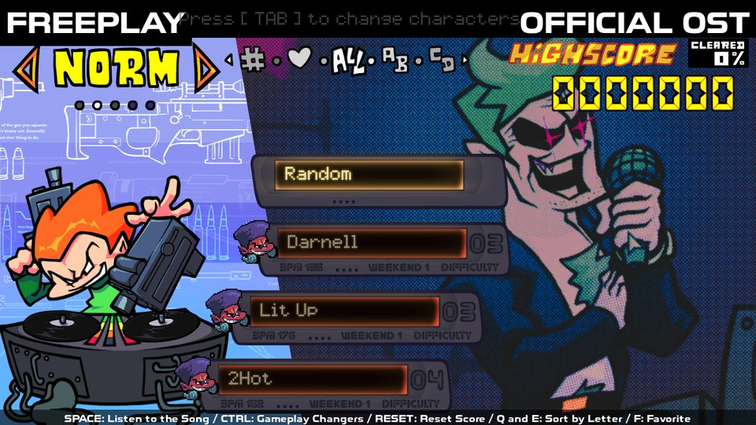
  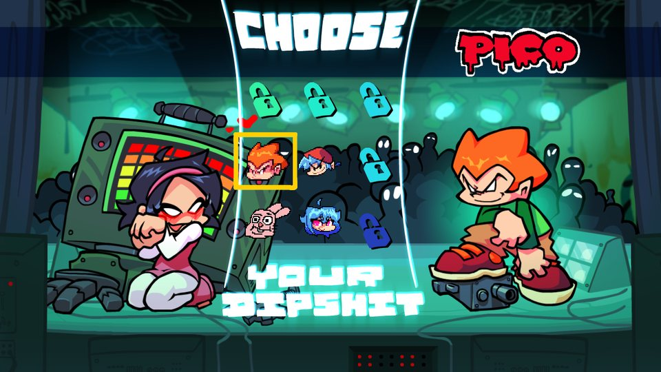

* **Freeplay style:** pick the classic Psych Freeplay or the V-Slice one, with the DJ, capsules, the "NEW" badge on songs you haven't played yet, favorites and sorting.
* **Character Select:** switch characters (press `TAB` in Freeplay) like in the official game.
* **Results screen:** ratings tally and rank animations (Perfect, Excellent, Great, Good, Loss) after each song.
* **Sticker transition** between Freeplay and the songs.

  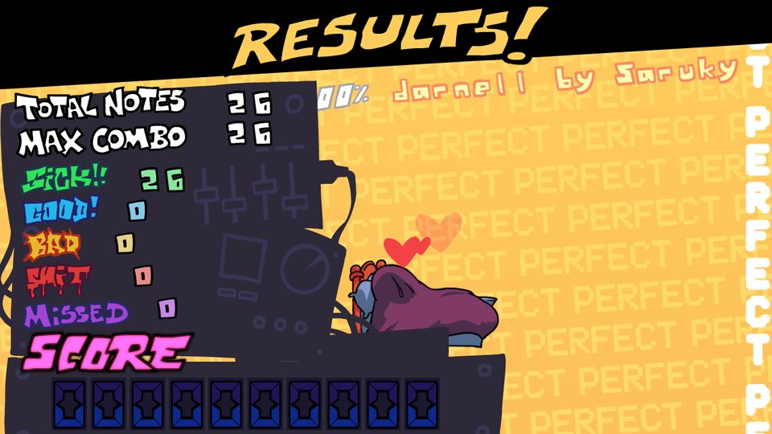

---

## 🌐 Online multiplayer

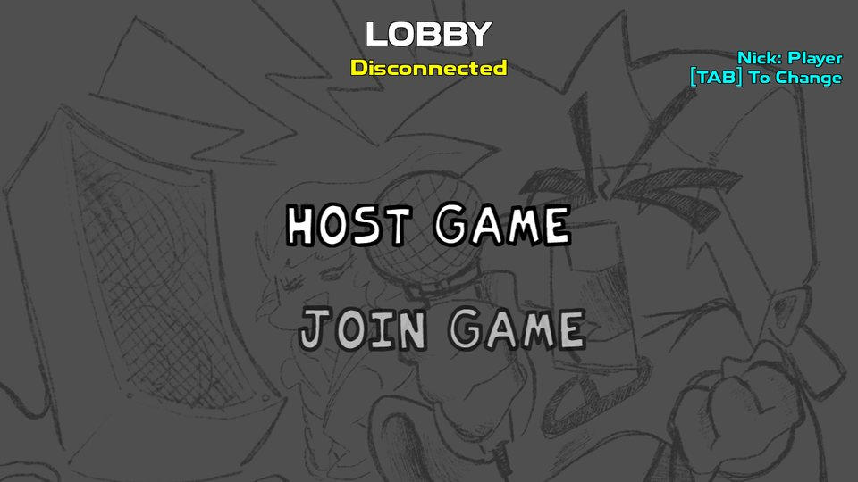

* **Host Game** waits for a friend; **Join Game** connects with the host's IP (port `8888`).
* Choose your nickname in the lobby (`TAB`).
* Each player plays one side of the chart, and both see each other's notes, misses and animations as they happen.
* Health drain added by a mod for the opponent's notes is blocked online, because the match already handles health.
* Scripts can check `onlinePlay` / `onlineHost` to change mechanics that would be unfair online.

 

---

## 🎮 Gameplay

  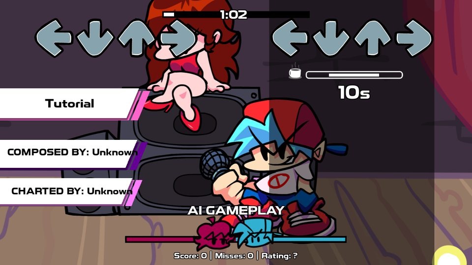
   Lane Underlay, the Break Timer ("10s") and the Song Credits Card.

**Gameplay changers**
* **Play as Opponent:** play the opponent's notes while the computer plays Boyfriend's.
* **Health Drain:** every note the opponent hits takes a little health (it never kills you).
* **Speed Up on Miss:** every miss makes the song 5% faster, up to 2x.
* **Ghost Notes:** two notes of the same character close together leave an afterimage of the first pose.

**New options**
* **Break Timer:** a countdown when there are 3 seconds or more without notes.
* **Lane Underlay:** dark lanes under your notes, with adjustable opacity.
* **Hold Note Covers:** the sparks on the receptors while you hold a long note.
* **Sustain Wiggle**, **Icon Bop**, **Smooth Health Bar** and **Sustains as One Note**.
* **Score Camera:** ratings and combo pop up on the HUD or in the stage.
* **Song Credits Card:** the song's name, composer and charter slide in when the song starts.
* **Animated health icons** (an `.xml` next to the icon) and **winning icons** (3 frames).
* **Window Mode** (windowed or fullscreen) and **Sharpness**.

  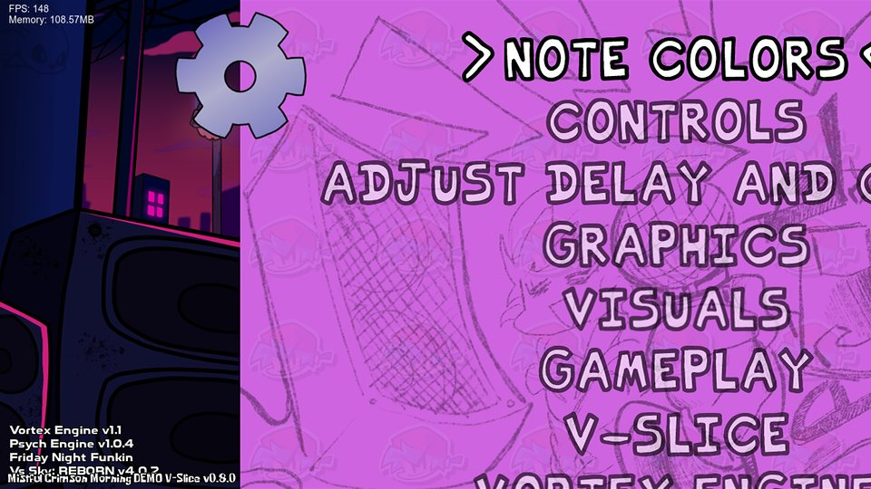
  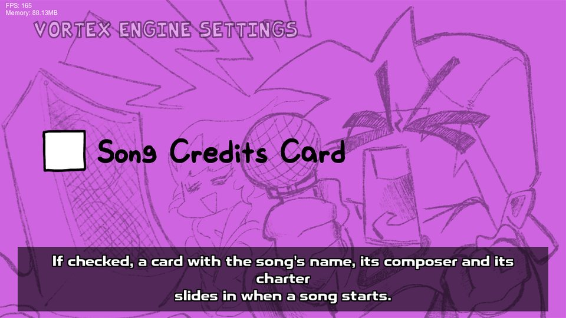
   The options menu slides in straight from the main menu. All of Vortex's options have their own page.

---

## 🛠️ Editors

  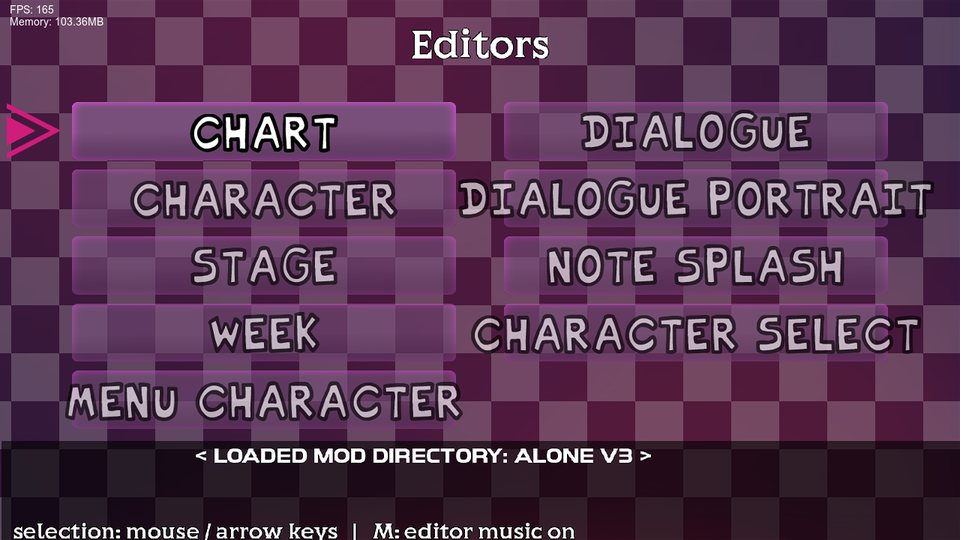
  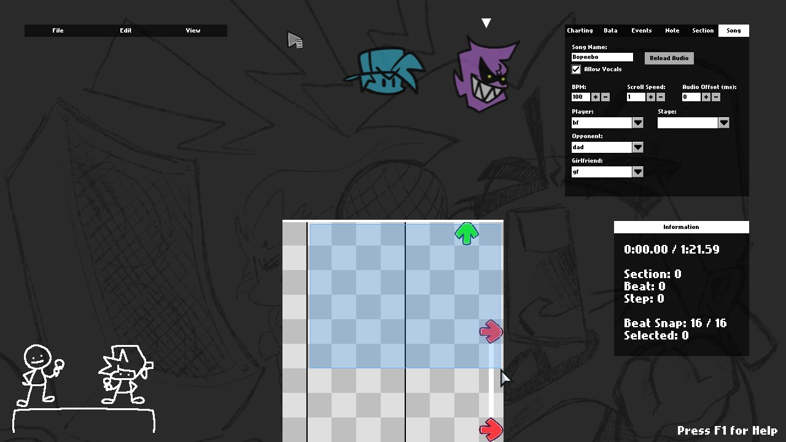

* **Chart Editor:** drag a box with the mouse to select notes, drag the selection to move it, cut / copy / paste and undo. Music plays when you leave it idle, like in V-Slice (`M` turns it off).
* **Stage, Character, Dialogue Portrait and Menu Character editors:** move things with the mouse, with undo.
* **Character Select & Results editor (new):** place the characters, portraits and results animations of a playable character, with a live preview. What you save works in the official V-Slice too.

  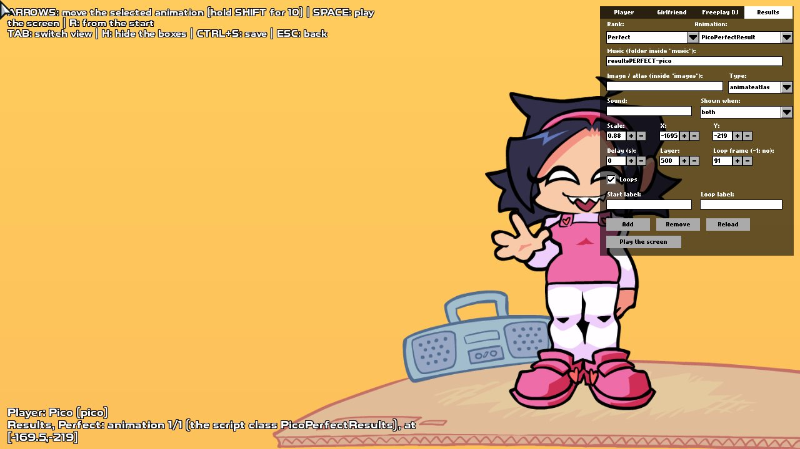
  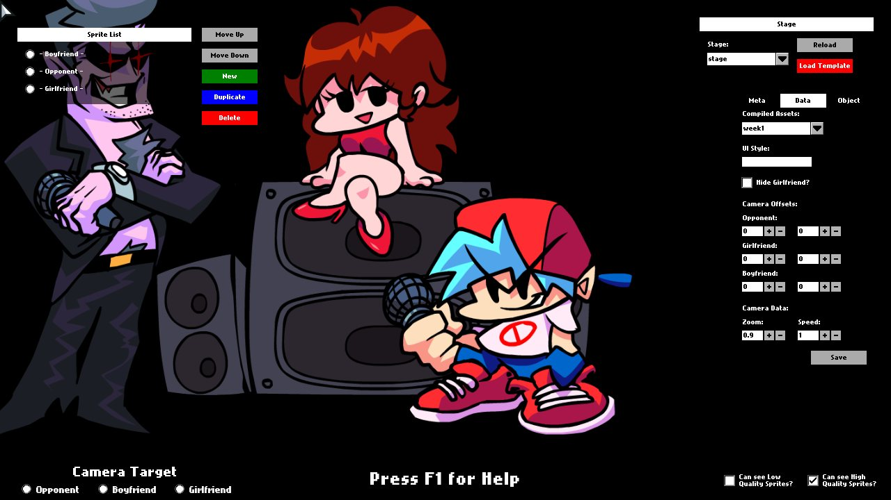

---

## 📜 Scripting

Everything Psych Engine's Lua and HScript can do still works, and so do V-Slice's `.hxc` scripts. On top of that, Vortex adds:

* `VortexEngine`, `playAsOpponent`, `onlinePlay` and `onlineHost` variables.
* Functions such as `setLaneUnderlay`, `setScoreCamera`, `setHiddenNotes`, `getTallies` and `startConversation` (V-Slice dialogue in Psych songs).
* Callbacks such as `onBreakStart` and `onBreakEnd`.
* Overlay, hardlight, difference and invert blend modes that really work on Lua sprites.
* Camera rotation without empty corners: no `zCameraFix` scripts needed.

The full list, with examples, is in [`scripts.txt`](scripts.txt).

---

## Installation

Refer to [the Build Instructions](/docs/BUILDING.md).

## Customization

If you wish to disable things like *Lua Scripts* or *Video Cutscenes*, you can refer to the `Project.xml` file.

Inside `Project.xml`, you will find several variables to customize the engine to your liking.

To start you off, disabling *Video Cutscenes* should be simple: delete the line `"VIDEOS_ALLOWED"` or comment it out by wrapping the line in XML-like comments, like this: `<!-- YOUR_LINE_HERE -->`

Same goes for *Lua Scripts*: comment out or delete the line with `LUA_ALLOWED`. This and other customization options are all available within the `Project.xml` file.

---

## Credits

### Vortex Engine
* VeritonR - Creator of Vortex Engine.

### Psych Engine
* Shadow Mario - Main Programmer and Head of Psych Engine.
* Riveren - Main Artist/Animator of Psych Engine.

### Special Thanks
* bbpanzu - Ex-Team Member (Programmer).
* crowplexus - HScript Iris, Input System v3, and Other PRs.
* Kamizeta - Creator of Pessy, Psych Engine's mascot.
* MaxNeton - Loading Screen Easter Egg Artist/Animator.
* Keoiki - Note Splash Animations and Latin Alphabet.
* SqirraRNG - Crash Handler and Base code for Chart Editor's Waveform.
* EliteMasterEric - Runtime Shaders support and Other PRs.
* MAJigsaw77 - .MP4 Video Loader Library (hxvlc).
* iFlicky - Composer of Psync, Tea Time and some sound effects.
* KadeDev - Fixed some issues on Chart Editor and Other PRs.
* superpowers04 - LUA JIT Fork.
* CheemsAndFriends - Creator of FlxAnimate.
* Ezhalt - Pessy's Easter Egg Jingle.
* MaliciousBunny - Video for the Final Update.
* The Funkin' Crew - Friday Night Funkin' and V-Slice.

***

#### Vortex Engine by VeritonR · Psych Engine by ShadowMario · Friday Night Funkin' by ninjamuffin99 and The Funkin' Crew
