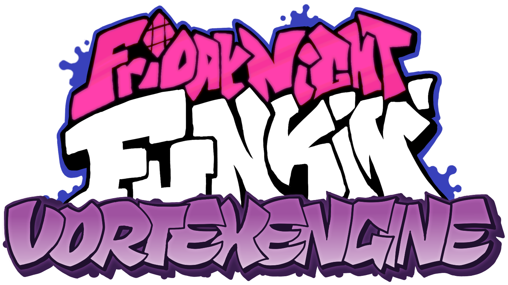
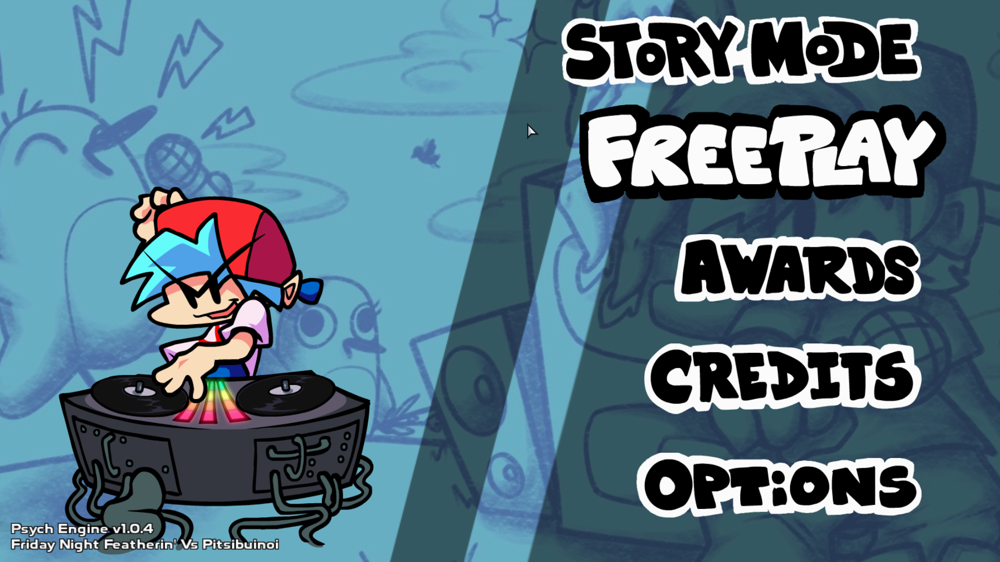
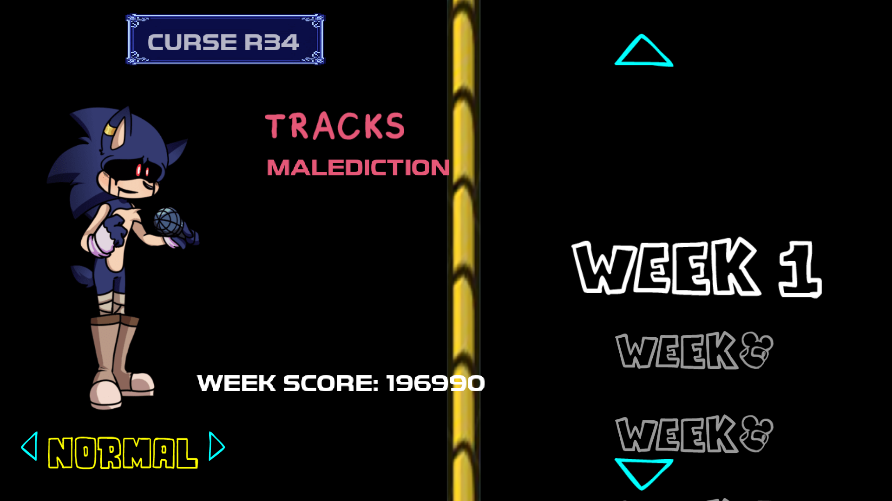
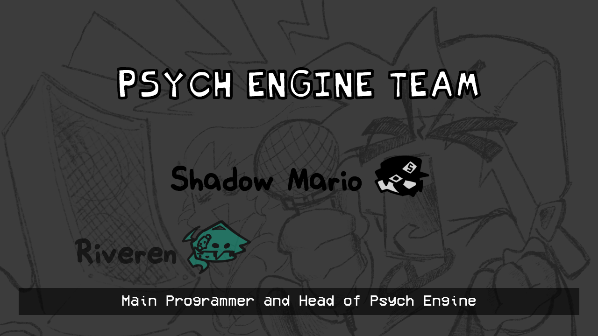
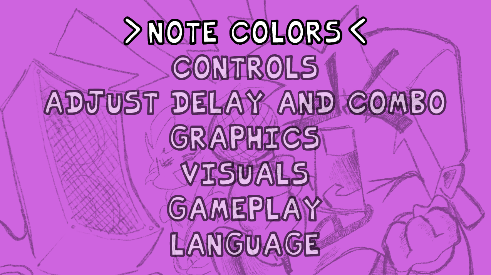

## Installation:

Refer to [the Build Instructions](/docs/BUILDING.md)

## Customization:

If you wish to disable things like *Lua Scripts* or *Video Cutscenes*, you can refer to the `Project.xml` file.

Inside `Project.xml`, you will find several variables to customize Psych Engine to your liking.

To start you off, disabling *Video Cutscenes* should be simple, simply delete the line `"VIDEOS_ALLOWED"` or comment it out by wrapping the line in XML-like comments, like this: `<!-- YOUR_LINE_HERE -->`

Same goes for *Lua Scripts*, comment out or delete the line with `LUA_ALLOWED`, this and other customization options are all available within the `Project.xml` file.

## Credits:
* Shadow Mario - Main Programmer and Head of Psych Engine.
* Riveren - Main Artist/Animator of Psych Engine.

### Special Thanks
* bbpanzu - Ex-Team Member (Programmer).
* crowplexus - HScript Iris, Input System v3, and Other PRs.
* Kamizeta - Creator of Pessy, Psych Engine's mascot.
* MaxNeton - Loading Screen Easter Egg Artist/Animator.
* Keoiki - Note Splash Animations and Latin Alphabet.
* SqirraRNG - Crash Handler and Base code for Chart Editor's Waveform.
* EliteMasterEric - Runtime Shaders support and Other PRs.
* MAJigsaw77 - .MP4 Video Loader Library (hxvlc).
* iFlicky - Composer of Psync, Tea Time and some sound effects.
* KadeDev - Fixed some issues on Chart Editor and Other PRs.
* superpowers04 - LUA JIT Fork.
* CheemsAndFriends - Creator of FlxAnimate.
* Ezhalt - Pessy's Easter Egg Jingle.
* MaliciousBunny - Video for the Final Update.

***

# Features

## New Main Menu
* A brand new menu that makes your experience even better!

## Main Story Song List:
### Week 1:
  * 
  * 
  * 
### Week 2:
  * 
  * 
  * 
### Week 3:
  * 
  * 
  * 
### Week 4:
  * 
  * 
  * 
### Week 5:
  * 
  * 
  * 
### Week 6:
  * 
  * 
  * 

## Story mode menu rework:

* Added a different BG to every song (less Tutorial)
* All menu characters are now in individual spritesheets, makes modding it easier.

## Credits menu

* You can add a head icon, name, description and a Redirect link for when the player presses Enter while the item is currently selected.

## Options menu:
* You can change Note colors, Delay and Combo Offset, Controls and Preferences there.
 * On Preferences you can toggle Downscroll, Middlescroll, Anti-Aliasing, Framerate, Low Quality, Note Splashes, Flashing Lights, etc.

## Other gameplay features:
  * 
  * 
  * 

#### Psych Engine by ShadowMario, Friday Night Funkin' by ninjamuffin99
